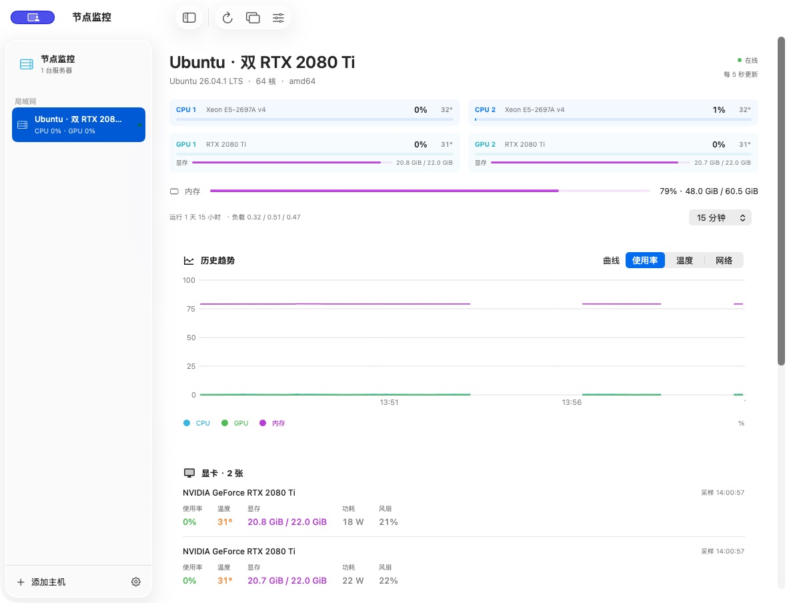
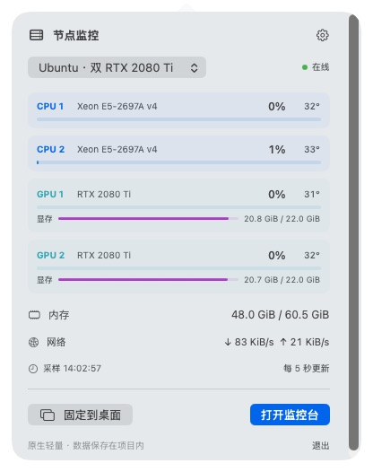
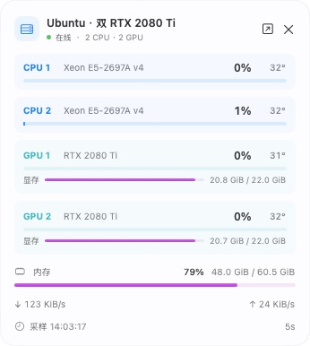
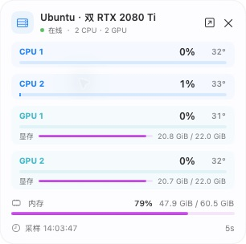

# 节点监控 · Node Monitor

一个面向 Linux 服务器的原生 macOS 监控工具。通过菜单栏、桌面挂件和监控台查看远程主机的 CPU、GPU、内存、显存、磁盘和网络状态。

Mac 客户端使用 SwiftUI / AppKit；服务器采集端使用 Go。采集端与客户端直接连接，不需要额外部署中心服务。

## 界面截图

| 监控台 | 菜单栏面板 |
| --- | --- |
|  |  |

| 标准桌面挂件 | 紧凑桌面挂件 |
| --- | --- |
|  |  |

截图展示的是实际界面，传感器和设备数量会因服务器而异。

## 主要功能

- 菜单栏与挂件按物理 CPU 和显卡分别显示使用率、温度；显卡还分别显示显存。
- 监控台显示 CPU、GPU、内存、磁盘、网络等数据，并提供历史曲线与可选提醒。
- 挂件支持拖动、两种尺寸、透明度、锁定和置顶。
- 多台服务器共用客户端连接缓存；断线后保留旧数据并标记状态。
- 基础指标默认每 5 秒采集，GPU 默认每 15 秒采集；界面全部隐藏时客户端降低轮询频率。
- 采集 API 只读，使用访问令牌认证，支持 TLS；远程连接也可使用 SSH 隧道。

CPU 插槽使用 Linux 拓扑识别；可对应的温度来自传感器。NVIDIA 数据来自 `nvidia-smi`。系统或驱动未提供的数据会显示为 `—`，不会当作零值。

## 下载和使用

从 [Releases](https://github.com/ansomeck-art/node-monitor/releases) 下载需要的文件：

- `NodeMonitor-macOS-arm64.zip`：Apple Silicon Mac 便携客户端，需要 macOS 14 或更新版本。
- `nodemon-agent-linux-amd64.tar.gz`：x86-64 Linux 服务器采集端。
- `nodemon-agent-linux-arm64.tar.gz`：ARM64 Linux 服务器采集端。
- `NodeMonitor-source.zip`：源码、截图及构建脚本；也可直接克隆此仓库。

解压 Mac 包后保留整个文件夹，双击其中的 `build/节点监控.app`；不要单独移走应用，因为同级项目标记用于定位配置和数据。首次使用可选择模拟演示，或在服务器运行采集端后添加主机。详细步骤见 [部署与使用](docs/部署与使用.md)。

Linux 采集端可在独立目录以普通用户运行。默认监听本机；跨网络连接推荐 SSH 隧道或 HTTPS。仅在可信局域网显式启用明文连接，不要将明文端口直接暴露到互联网。

发行包不包含服务器连接信息、令牌或历史数据。应用为临时签名版本，**尚未经过 Apple Developer ID 签名和公证**，macOS 可能提示无法验证开发者，使用前需要按系统提示确认。

## 平台和限制

- 已在一台 Ubuntu x86-64、双 CPU、双 NVIDIA 显卡的主机上进行实机验证；Linux ARM64 仅完成交叉编译。
- Intel Mac 客户端和 Windows 服务器采集端尚未实现；AMD / Intel 显卡的部分数据依赖内核支持，尚未实机验证。
- CPU 温度、GPU 功耗和风扇等数据依赖硬件、驱动和采集权限。普通内存不保证提供温度。
- 本地历史只在 Mac 客户端运行并连接时记录；休眠或断网期间不补造数据。
- `nvidia-smi` 可能影响 GPU 空闲功耗；资源使用和能耗因机器、采样频率及显示状态而异。
- 多显示器、拥挤菜单栏、长期能耗和更多服务器组合仍需进一步验证。

## 从源码构建

需要 Apple Silicon Mac、macOS 14+、Swift 6 和 macOS SDK。构建脚本在项目目录内准备工具与缓存；未安装 Go 时会下载固定版本的官方 Go 工具链并校验 SHA-256。

```bash
bash scripts/build.sh
bash scripts/test.sh
bash scripts/package.sh
```

也可以通过 `GO_BIN=/绝对路径/go` 使用已有 Go。构建和运行不会自动安装全局软件或注册后台服务。可选的 Linux systemd 服务模板和卸载步骤见 [部署与使用](docs/部署与使用.md)。

| 路径 | 内容 |
| --- | --- |
| `Sources/` | macOS 界面、协议与数据处理 |
| `Agent/` | Linux 采集端和只读 API |
| `Tests/` | 客户端与采集端测试 |
| `scripts/`、`Tools/` | 构建、打包与辅助工具 |
| `deploy/` | 可选的 Linux 启动模板 |
| `docs/`、`design/` | 使用说明、截图与设计资料 |

运行时的配置、令牌和历史保存在项目的 `data/` 下；不要将该目录提交或分享。更多协议说明见 [实现范围与协议](docs/实现范围与协议.md)。

## 许可

本项目使用 [MIT License](LICENSE)。
