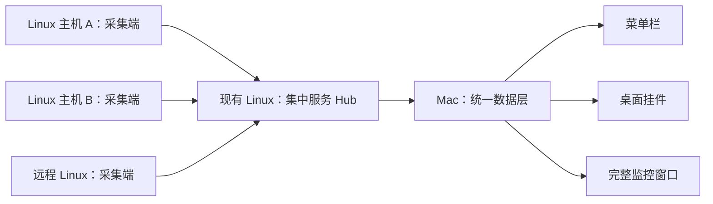

# 节点监控：Mac + Linux 完整开发方案

版本：方案 v2，2026-10-28。

状态更新：本文件保留最初的完整产品蓝图和长期目标。2026-10-28 已按下述 B 路线完成 0.1.0 首版，并连接 Ubuntu 26.04.1 双 NVIDIA 主机。实际交付范围和边界以 [实现范围与协议](../docs/实现范围与协议.md) 为准；本文件中其他未实现条目仍属后续计划。

## 1. 产品目标与交付

在 Mac 上常驻查看局域网和远程 Linux 主机，提供菜单栏、桌面实时挂件、完整监控窗口三种入口。所有入口共用连接、采集结果和历史查询，不因多开一个挂件重复采集。

交付包括：

1. Mac 原生应用、安装包、中文界面、设置与卸载说明。
2. Linux 采集端发行包、systemd 服务定义、配置模板、更新与卸载说明。
3. 若采用推荐复用路线，同时提供集中服务 Hub 的固定版本部署包、数据目录与备份说明；Hub 可放在一台现有 Linux 上。
4. 两端配对与连接说明、设备兼容表、功能验收记录和资源占用实测报告。

首个验证目标为当前 Apple Silicon Mac，以及 Ubuntu 22.04 / 24.04 的 x86_64 与 ARM64 主机。上述 Linux 版本、架构属于计划验证范围，不代表已经兼容。Intel Mac、其他发行版、Windows、AMD / Intel GPU、Jetson 和 NAS 专有接口分阶段扩展。

## 2. 优先复用现有开源能力

已找到的项目与证据见 [GitHub 项目调研](GitHub项目调研.md)。推荐先验证 Beszel 服务端，Mac 客户端独立实现。

| 路线 | 组成 | 优点 | 要承担的工作 |
| --- | --- | --- | --- |
| A：优先验证 | Beszel Agent + Beszel Hub + 自己的 Mac 客户端 | 复用采集、历史、告警、认证与远程接入 | 增加一个 Hub；适配实时频率、GPU 字段、原生挂件与版本兼容；测量三部分总占用 |
| B：精简直连备选 | 精简 Go Agent + 自己的 Mac 客户端 | 运行组件少、采集范围与频率容易限定 | 自行实现采集协议、配对、缓存、重连和本地历史；Mac 不在线时的全天历史需额外开发 |

原计划先验证 A，再决定是否采用 B。首版实施时为控制 GPU 查询频率、减少常驻组件和便于整体删除，直接选择 B；未开展 Beszel 的实机比较，不能据此断言它更耗资源。下文 A 结构保留为后续集中历史方案的参考。

BeszelBar 可用来了解现有菜单栏客户端，但其现有功能与前面效果图不等同。当前 README 声明 MIT，但文件树中未看到独立许可文件；明确授权前不复制其实现。AirStats、Stats、ArgusDesk 的能力范围与使用价值也记录在调研文档中。

## 3. 系统结构

推荐路线 A：

- 每台主机一个 Agent，一台常在线机器运行 Hub；同一机器可以同时运行 Agent 与 Hub。
- Agent 向 Hub 建立经过认证的连接；Mac 访问 Hub 获取最新指标、历史和事件。远程主机可以主动连接能够访问的 Hub。
- Hub 保存历史，Mac 只保存设置、必要缓存和连接凭证。Mac 休眠后，仍在线的服务器与 Hub 可以继续记录历史。
- Mac 使用原生界面，所有窗口共用一个数据中心。服务器端与 Mac 界面分别构建、分别升级，保持协议兼容范围可检查。

路线 B 保留相同的 Mac 数据层接口，将数据提供者切换为 Agent 直连，历史改由 Mac 本地保存。UI 不直接依赖特定服务端字段。

## 4. Mac 功能范围

| 页面 / 入口 | 首版功能 |
| --- | --- |
| 菜单栏 | 选择主机；显示 CPU / GPU / 指定温度 / 异常摘要；自定义显示项目与宽度 |
| 展开面板 | 主机切换、CPU / GPU / 内存 / 显存卡片、短曲线、更新时间、打开详情、固定到桌面 |
| 桌面挂件 | 单主机小 / 中尺寸；拖动、锁定、透明度、选择置顶、位置与屏幕记忆；不同主机可并列 |
| 完整窗口 | 主机分组、逐 GPU 信息、负载 / 温度 / 网络曲线、磁盘列表、15 分钟 / 1 小时 / 24 小时切换 |
| 主机设置 | 地址与连接状态、友好名称、分组、显示字段、传感器选择、能力与版本信息 |
| 提醒 | 高温、持续高占用、内存或磁盘不足、离线；显示触发值、持续时间与恢复状态 |
| 通用设置 | 登录启动、浅 / 深色、刷新模式、单位、通知、缓存与历史边界说明 |

桌面挂件采用应用自己的 AppKit 窗口 / NSPanel 与 SwiftUI 内容。WidgetKit 刷新由系统调度，不承担首版持续实时显示。窗口关闭后应用保留菜单栏；退出应用才停止 Mac 端显示与本地处理。

当前三张视觉稿：

- [菜单栏概念图](01-menubar.png)
- [桌面挂件概念图](02-desktop-widgets.png)
- [完整监控台概念图](03-dashboard.png)

视觉稿使用示例数据。真正实现时统一采样时间、时间轴、数据单位和状态标识。

## 5. Linux 采集范围

| 类别 | 首版指标 | 来源 / 边界 |
| --- | --- | --- |
| CPU | 总使用率、负载、逻辑核心数、温度 | 操作系统统计与已识别传感器；CPU 使用率统一为整机 0–100% |
| GPU | 每张卡名称、使用率、温度、显存已用 / 总量、功耗、风扇（支持时） | 先验证 NVIDIA；按稳定设备 ID 区分多卡；NVML 或既有受支持采集方式 |
| 内存 | 已用、可用、总量、Swap | 明确 Linux 缓存计算口径；界面与服务端一致 |
| 磁盘 | 分区容量、读写速率 | 由计数器差值计算速率；SMART / 温度作为后续独立适配项 |
| 网络 | 每网卡收发速率、累计流量 | 识别真实网卡与虚拟接口；避免重复累计 |
| 主机 | 系统、架构、运行时间、采集版本、连接与更新时间 | 区分整台机器可达、Agent 可用和单指标有效 |

传感器保留来源、设备名称、标签与单位。不能把任意 temp1 自动命名为 CPU 温度。内存温度仅在存在已识别的传感器时提供；云主机或虚拟机未暴露的物理温度无法补算。

每个字段支持以下状态：有效、设备不存在、不支持、权限不足、采集失败、数据过期。缺失值显示“未提供”或具体原因；真实零值仍可正常显示。

基础采集以普通服务账号运行。读取设备或安装服务需要的额外权限单独说明；不把长期 root 运行作为默认前提。首版仅做监控，不提供硬件调参或远程命令执行入口。

## 6. 低资源占用设计

用户目标是“长期挂着基本无感”。CPU、内存、唤醒、磁盘写入、GPU 空闲功耗和 Mac 电池影响一起测量，不能只看某一瞬间 CPU。

默认策略：

- 挂件可见或详情打开时，目标每 5 秒获得一次新指标；所有显示入口共享结果。
- 菜单收起、详情关闭且没有可见挂件时，优先使用服务端常规低频摘要，停止曲线绘制和高频订阅。菜单栏明确呈现数据时间，不能让低频数据看起来像刚采样。
- 节能模式降低更新频率，并在界面显示当前模式。可见桌面挂件可以持续保持 5 秒模式。
- 高频只读取 CPU、内存、GPU 与必要温度；系统静态信息启动时获取，容量等低频字段分开调度。历史查询仅在用户打开相应视图时执行。
- 内存中的曲线缓冲区有上限，长时间窗口先降采样后绘制；相同历史查询合并，避免每个挂件各查一遍。
- 使用服务器原生指标接口，避免每次采样重新启动解释器或遍历全部进程。日志限速，数据写入批处理，按保留策略清理。

重要适配：Beszel v0.21.1 的常规保存周期为 60 秒，实时订阅周期为 1 秒。需要将实时请求与缓存周期一起适配到 5 秒，并检查 Agent 内部 GPU 采样频率；只降低 Mac 重绘频率并不能降低远端全部开销。适配使用集中配置并补齐版本兼容测试，不将同一常量散落修改。

NVIDIA 的 NVML 方式在 Beszel 文档中仍标注实验性；目标硬件上需要同时比较准确性、稳定性及 GPU 空闲功耗。不能为了显示温度让原本空闲的显卡长期保持高功耗而不报告。

初始性能预算，均为开发目标，尚未实测：

| 场景 | 初始目标 | 测量条件 |
| --- | --- | --- |
| Mac 后台菜单栏，3–5 台主机 | 平均 CPU <1%，内存占用 ≤150 MB | release 构建，低频后台模式；同时记录系统报告的能耗与唤醒 |
| Linux Agent，基础指标及 0–1 张 GPU | 平均 CPU <1% 单核，RSS ≤80 MB | 5 秒模式；NVML / 驱动相关的进程内存计入，不隐去 |
| Hub，3–5 台主机 | 平均 CPU <1% 单核，RSS ≤150 MB | 常规历史采集、一个 Mac 客户端；附加实时订阅场景另测 |
| Mac 可见挂件与完整监控台 | 单独记录 CPU、内存、能耗及曲线点数 | 不把后台目标冒充为打开所有窗口时的结果 |

测量方法：预热 5 分钟后，分别记录至少 30 分钟的未运行基线、后台、挂件、完整窗口与断线重连场景；记录均值、峰值、分位数与测试硬件。CPU 使用统一为单核 100% 的进程口径，Mac 内存指标与 Linux RSS 分开命名。再进行连续运行验证，检查缓存、连接、日志、CPU 和内存是否随时间持续增长。

Hub 与 Agent 同机时另外报告合计占用；所有 Linux 主机的监控总开销也单独汇总。如果测量未达目标，先优化频率、非必要采集和界面，再按路线选择规则决定是否改为精简直连。

## 7. 数据与版本契约

Mac 数据层至少包含以下逻辑模型，具体网络字段由适配层转换：

- Host：主机 ID、名称、系统、架构、能力、Agent / Hub 版本。
- Snapshot：主机 ID、序号、采样时间、接收时间、实际采样周期、各项指标和字段状态。
- GPU：稳定 ID、名称、使用率、显存、温度、功耗、支持能力。
- Sensor：设备与传感器标识、标签、原始单位、来源、有效时间与状态。
- History：主机、设备、指标、时间范围、数据分辨率、缺口与聚合方式。
- Event：发生时间、主机、指标、阈值、持续时间、触发 / 恢复状态和去重标识。

传输中的容量采用字节、温度采用摄氏度、速率采用每秒字节。UI 统一显示 GiB / MiB/s 或用户选择的单位。显存占用与 GPU 计算使用率分别呈现。

CPU 与吞吐速率按前后两次计数器及真实时间差计算。主机重启、计数器重置、时间跳变和丢样需要重建基线。Mac 不通过补零或插值掩盖断线。

支持的服务端版本范围写入应用。服务端未知字段忽略处理，关键字段缺失时显示兼容问题；升级前使用固定数据样本与真实实例验证。精简直连备选路线使用版本化协议，不让 UI 绑定其内部字段。

## 8. 连接、配对与访问

局域网：Mac 与 Agent 都能访问 Hub，首次在 Mac 配置 Hub 地址并进行认证。后续保留凭证，主机列表从授权数据中获取。

互联网：优先复用已有 VPN；需要公网接入时，Hub 提供经过正确证书校验的 HTTPS，Agent 主动建立认证连接。Hub 也可经现有 SSH 隧道访问。网络不可达与认证失败分开提示。

配置与凭证：

- Mac 凭证存 Keychain；服务端凭证放受权限限制的本地配置或官方支持的凭证文件。
- 客户端使用满足查看需求的最小权限账号。凭证轮换或撤销后能够重新配对，不能无限自动重试。
- 配对信息与诊断报告不包含明文秘密；日志只记录脱敏标识。
- TLS 校验失败显示具体问题；不以自动忽略证书作为解决方式。
- 首次提供手动添加与清楚的部署说明；自动局域网发现不作为首版必要功能。

应用只连接用户配置的目标。部署、端口与服务配置等操作在真正实施时按目标机器执行，不由本次方案整理自动触发。

## 9. 断线、历史与告警

连接状态区分：正在连接、在线、数据过期、离线、认证失败、权限不足、版本不兼容。

可见实时模式下，过期阈值按实际周期计算，例如 max(3 × 采样周期, 15 秒)；后台 60 秒摘要使用相应阈值。单个 GPU 失败不应把整机所有字段清空；Hub 连接失败不能据此断言每台服务器都已关机。

断线后保留最后读数并标记时间，曲线保留缺口；采用带随机抖动的退避重连，正常采样周期与失败重试分离。Mac 睡眠时暂停连接与绘图，唤醒后恢复连接并查询历史缺口。

路线 A：历史以 Hub 为权威，首版 UI 提供 24 小时查看。保留时长与聚合方式使用 Hub 实际支持和配置的策略，部署时记录；若需要严格的空间上限，另设可验证的保留 / 清理配置。不能只因为 UI 显示 24 小时就认定数据库只保留 24 小时。

路线 B：Mac 使用 SQLite 保存有界历史；Mac 休眠或关闭时存在历史缺口，除非另行增加服务器持久存储。

告警规则包含阈值、持续时间、恢复阈值与冷却期。高 GPU 使用率可能是正常工作状态，默认不将其简单等同故障。首版优先提供 Mac 本地通知；Mac 睡眠时无法保证通知送达。路线 A 的服务器规则可以继续记录事件，Mac 恢复后同步；邮件或其他外部通知需后续明确配置。

## 10. 部署、升级与卸载

Linux：提供匹配架构的发行包、校验值、配置样例和安装说明。优先单程序 + systemd；服务安装完成后以专用账号运行。安装步骤明确列出创建的服务、目录、端口和需要的权限。

Mac：提供 .app 与 DMG，首次配置地址、认证、主机分组和挂件。面向其他用户分发时使用合适的 Developer ID 签名与公证；开发机验证使用本地构建。签名与公证条件在打包阶段核对。

更新：首版使用版本提示与手动更新，保留回退所需的旧版本与配置；服务端升级前备份数据并检查数据库兼容性。凭证和主机配置不因更新而无意丢失。

卸载：停止服务、移除程序与服务定义；历史数据和配置默认保留并标明位置，彻底清理作为单独操作。Mac 提供清楚的退出、取消登录启动和移除挂件入口。

## 11. 开发阶段与完成条件

| 阶段 | 工作 | 可评审交付 |
| --- | --- | --- |
| 0：复用与性能验证 | 一台 Linux，Beszel 固定版本，基础指标与 NVIDIA；核对实时 / 历史协议与采样周期 | 字段与兼容表、真实读数对照、三部分资源报告、A / B 路线结论 |
| 1：两端最小闭环 | Linux 部署包、Mac 配对、最新快照、断线重连、能力缺省 | 一台真实服务器在 Mac 显示；拔网、恢复和无 GPU 情况可演示 |
| 2：三种界面 | 菜单栏、桌面挂件、完整窗口、统一数据层 | 前面概念图对应的可操作界面；多个窗口不重复连接 |
| 3：历史与提醒 | 曲线查询、阈值、去重、恢复事件、睡眠唤醒与设置持久化 | 真实历史与故障演示，明确全天历史和通知边界 |
| 4：交付与长时间验证 | 发行包、部署与卸载、版本兼容、连续运行与资源优化 | 安装包、操作文档、功能 / 性能记录和已知限制 |

两端在同一个协议与验证样本基础上推进，先真实采集，再补齐展示。首版完成以真实服务器与 Mac 端到端验收为准。

开发时间在阶段 0 后按实测复用程度估算；暂不把未经验证的硬件适配和开源兼容工作写成确定交期。

## 12. 验收清单

1. 同时间窗口对照服务器原生统计，区分瞬时值、平均值、容量与吞吐，不只验证接口返回成功。
2. 无 GPU、多个 GPU、无温度、权限不足、驱动不支持时正确显示各字段状态。
3. 网络中断、慢请求、服务重启、认证过期、Hub 不可达时界面不假装实时在线，不产生请求堆积。
4. Mac 休眠 / 唤醒、锁屏、切换桌面、显示器接拔、挂件锁定与位置恢复符合设置。
5. 菜单栏、挂件与详情显示同一个设备和同一份快照；历史聚合与单位标注明确。
6. 仅在阈值持续满足时通知，重复异常不过度提醒，恢复事件可追踪。
7. release 构建通过后台、挂件、详情三种性能测试；报告 Agent、Hub、Mac 各自占用与整体代价。
8. 安装、更新、回退与卸载说明可在目标系统执行；数据库回退限制提前记录。

## 13. 首版边界与后续扩展

首版集中完成 Linux / Ubuntu、基础硬件与 NVIDIA、多主机、菜单栏、实时桌面挂件、24 小时视图、断线恢复和本地通知。

后续按实际需要扩展 Windows、AMD / Intel GPU、NAS 专有 API、SMART、进程与容器详情、更长历史、自动发现、iPhone 查看和独立通知渠道。每项扩展单独测量增量开销，避免监控工具逐步变成高负担后台服务。

## 14. 参考资料

- [Beszel 仓库](https://github.com/henrygd/beszel)与 [v0.21.1](https://github.com/henrygd/beszel/releases/tag/v0.21.1)
- [Beszel Agent 安装](https://beszel.dev/guide/agent-installation)、[Hub 安装](https://beszel.dev/guide/hub-installation)、[GPU 说明](https://beszel.dev/guide/gpu)
- [Beszel 常规周期源码](https://github.com/henrygd/beszel/blob/v0.21.1/internal/hub/systems/system_manager.go)、[实时订阅源码](https://github.com/henrygd/beszel/blob/v0.21.1/internal/hub/systems/system_realtime.go)
- [Apple MenuBarExtra](https://developer.apple.com/documentation/swiftui/menubarextra)、[NSPanel](https://developer.apple.com/documentation/appkit/nspanel)、[WidgetKit 更新](https://developer.apple.com/documentation/widgetkit/keeping-a-widget-up-to-date)
- [Linux hwmon](https://docs.kernel.org/hwmon/sysfs-interface.html)
- 精简直连备选可使用 [gopsutil](https://github.com/shirou/gopsutil)与 [NVIDIA go-nvml](https://github.com/NVIDIA/go-nvml)，构建与运行依赖需按目标架构验证。
- [systemd 服务文档](https://www.freedesktop.org/software/systemd/man/latest/systemd.service.html)

本文是后续开发依据。本次只进行了本地文档与公开资料核对，没有执行安装、服务器扫描、远程连接或生产配置变更。
